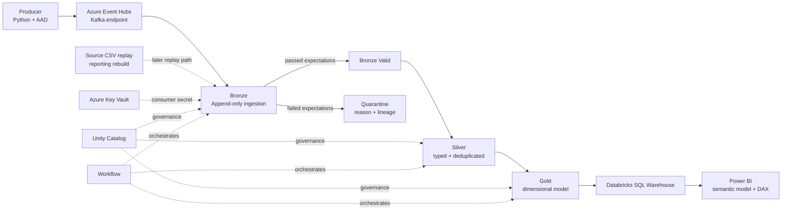
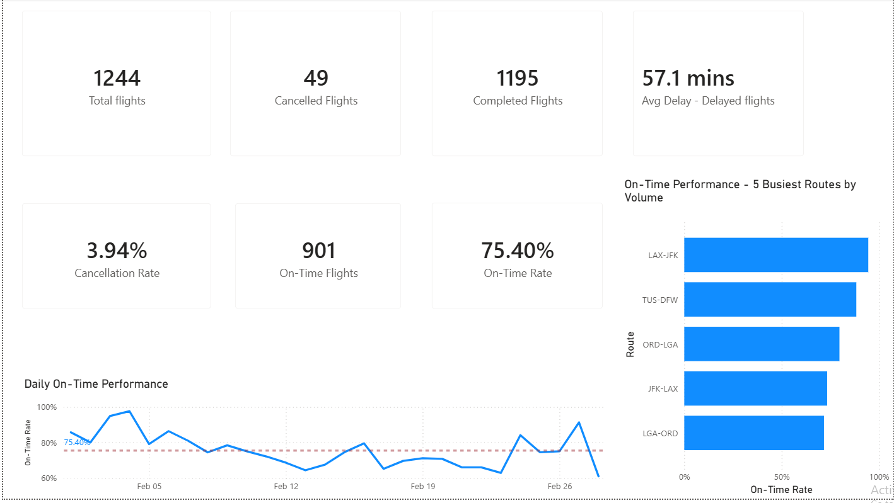
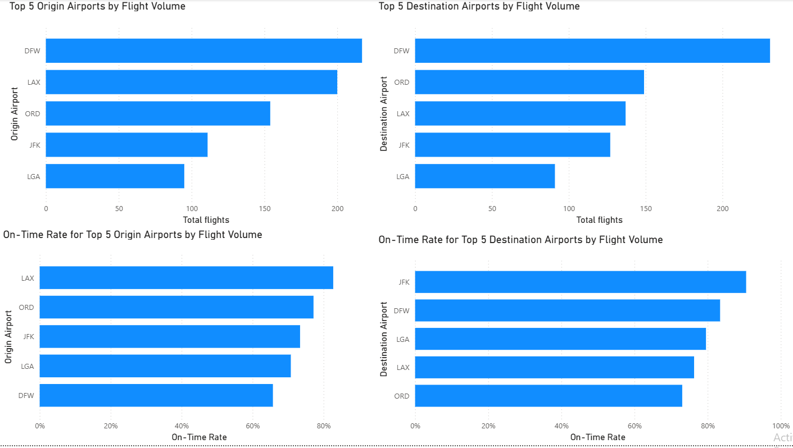
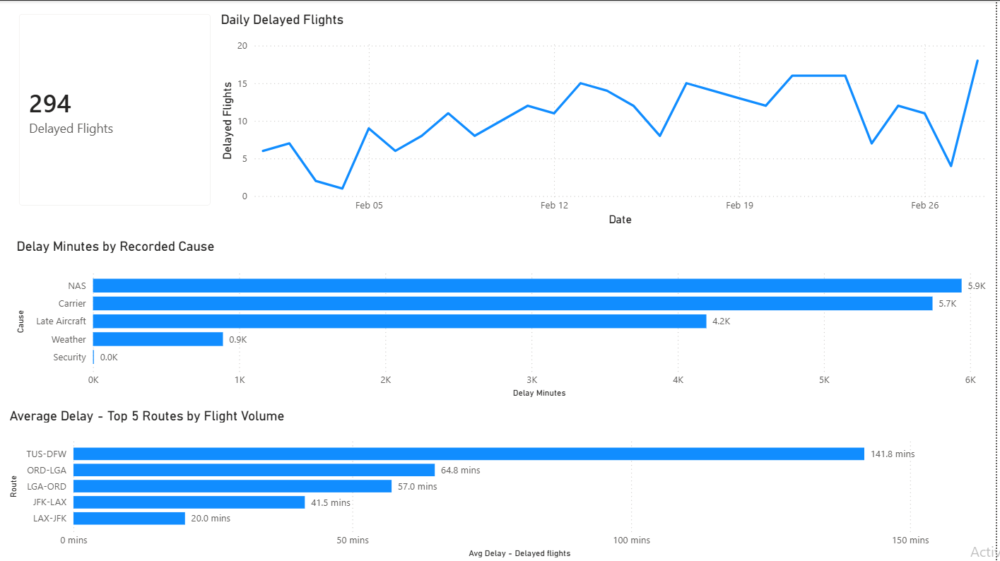

# Airline Lakehouse & Operations Analytics Platform

> **End-to-end Azure data platform from Event Hubs ingestion through Databricks medallion processing to a validated Power BI operational reporting layer — Unity Catalog governance, AAD-first authentication, idempotent Silver processing, quarantine, failure testing, Terraform IaC, dimensional modelling and source-to-report reconciliation.**

A production-aligned portfolio project built to demonstrate not only that a data pipeline runs, but that the data remains trustworthy from ingestion through the final business metric.

The original implementation streamed airline flight data through **Azure Event Hubs into Databricks Lakeflow Declarative Pipelines / DLT**. After the original Azure infrastructure was decommissioned to control cost, the analytical layer was later regenerated from the same source extracts through a **file-replay pipeline** and connected to **Power BI through a Databricks SQL Warehouse**.

The reporting rebuild replays the same two extracts used in the deduplication proof (`ONTIME_REPORTING_022` and `ONTIME_REPORTING_03`), which is why Gold and Power BI both hold **1,244 flights**. The late-arriving `ONTIME_REPORTING_021` file used to test late data in the streaming phase is not part of the reporting rebuild.

The original streaming execution evidence is retained separately from the Power BI extension.

---

## At a glance

- **Original streaming Bronze:** 1,862 events ingested → 1,858 valid + 4 quarantined
- **Silver:** 1,244 deduplicated logical flights on a 7-column business key
- **Gold:** flight-level fact table + carrier, airport and date dimensions; a route dimension was added in the reporting rebuild
- **Power BI:** 3-page operational reporting layer over the Databricks Gold model
- **Reporting KPIs:** 1,244 flights, 49 cancellations, 1,195 completed flights, 901 on-time flights
- **On-time rate:** 75.40% of completed flights
- **Delayed flights:** 294
- **Average delay:** 57.1 minutes among delayed operated flights
- **Validation:** Power BI `[Total Flights]` reconciled exactly to Databricks SQL — **1,244 = 1,244**
- **Delay causes:** recorded cause minutes equal total arrival delay for the 294 delayed flights — **16,776 = 16,776**
- **Reliability:** induced Key Vault authentication incident with full written postmortem
- **Terraform IaC:** validated 10-resource infrastructure plan
- **SQL:** 10 interview-grade analytical queries against the Gold model

---

## Architecture



### Two execution paths

**Original streaming implementation**

```text
Python producer
    ↓
Azure Event Hubs
    ↓
Databricks Bronze
    ↓
Silver
    ↓
Gold
```

This is the original implementation retained in the repository with execution evidence.

**Power BI extension**

```text
Original source extracts
    ↓
Databricks file-replay ingestion
    ↓
Bronze
    ↓
Silver
    ↓
Gold
    ↓
Databricks SQL Warehouse
    ↓
Power BI
```

The reporting extension deliberately did **not** recreate Event Hubs because streaming infrastructure was unnecessary for rebuilding the analytical layer.

---

## Authentication and governance

The original platform uses an **AAD-first authentication model** wherever the SDK supports it.

- Producer → Event Hub using Azure identity rather than secrets embedded in code
- DLT consumer → Key Vault-backed secret scope where Kafka SASL requires a connection string
- Unity Catalog for governed data objects
- Azure RBAC scoped to the required resources rather than broad namespace-level access
- Infrastructure and data-governance permission planes treated separately

This produced a useful operational lesson during development: a healthy Azure resource does not imply that the Databricks identity chain can access it correctly.

---

# Four things this project proves

## 1. Idempotent deduplication survives operator error

During development I accidentally sent the same **614-row source file twice**.

Bronze is intentionally append-oriented, so the duplicate delivery was retained:

```text
Bronze: 1,858 rows
Silver: 1,244 rows
```

Silver resolved the duplicate records against a **7-column logical-flight business key** using Lakeflow `apply_changes` (keys plus `sequence_by` on the Event Hubs enqueue time), which upserts rather than appends, and returned exactly the expected number of unique flights.

The mistake became stronger evidence than a synthetic unit test: the deduplication logic handled a real operator error without corrupting the analytical layer.

**Evidence:**  
[`phase4_silver_dedup_proof.png`](docs/Evidence/phase4_silver_dedup_proof.png)

---

## 2. Quarantine routing works because I deliberately broke the input

An empty quarantine table does not prove that quarantine logic works.

I therefore created `send_bad_events.py` with four traceable malformed records:

```text
BAD_001
BAD_002
BAD_003
BAD_004
```

All four were routed to `events_quarantine` with reason codes while the valid data path remained clean.

The DLT expectation metrics reconciled to the table counts.

**Evidence:**  
[`phase3_quarantine_proof_01.png`](docs/Evidence/phase3_quarantine_proof_01.png)

A later file-replay run also exposed real schema drift: one source file contained an unexpected trailing column. The pipeline surfaced **614 expectation warnings** rather than silently dropping 614 otherwise valid flight records.

That warning was deliberately retained rather than promoted immediately to a drop rule because the anomaly did not invalidate the underlying flight records.

---

## 3. I induced a real authentication failure and wrote the postmortem

I deliberately corrupted the Event Hub connection string stored in Azure Key Vault.

The DLT pipeline successfully reached Key Vault, retrieved the incorrect secret, then failed at the Kafka authentication boundary and remained in retry until cancelled.

```text
Failed run: 2h 6m
Recovery run: 1m 56s
```

I diagnosed the incident by tracing the failure backwards through the authentication chain:

```text
DLT
→ Kafka client
→ Event Hub authentication
→ Key Vault secret
```

The correct secret was restored, the pipeline recovered successfully, and the incident was documented with detection and prevention improvements.

**Full postmortem:**  
[`docs/postmortem.md`](docs/postmortem.md)

The important lesson was not simply that the secret was wrong:

> A green infrastructure layer does not prove that the runtime authentication chain is healthy.

---

## 4. The reporting layer reconciles back to the data platform

The project now continues beyond Gold into a Power BI reporting layer.

Power BI connects to the Databricks Gold model through a **Databricks SQL Warehouse** using **Import mode**.

Before accepting the dashboard, the first core KPI was independently reconciled.

Databricks SQL:

```sql
SELECT COUNT(*)
FROM fact_flights;
```

Result:

```text
1,244
```

Power BI:

```DAX
Total Flights =
COUNTROWS(fact_flights)
```

Result:

```text
1,244
```

Therefore:

```text
Databricks Gold = 1,244
Power BI        = 1,244
```

The reporting layer was not considered correct merely because the visuals rendered successfully.

**Evidence:**  
[`01_powerbi_total_flights_1244.png`](docs/Evidence/power-bi-extension/01_powerbi_total_flights_1244.png) · [`02_databricks_total_flights_1244.png`](docs/Evidence/power-bi-extension/02_databricks_total_flights_1244.png)

Business definitions were also made explicit:

- cancelled flights are excluded from the on-time-rate denominator
- an operated flight is considered on time when arrival delay is under 15 minutes
- cancelled flights are excluded from recorded delay-cause totals
- delay-cause minutes come from the source's recorded cause fields, which BTS populates only for flights arriving 15 or more minutes late
- early arrivals cannot be distinguished from exactly-on-time arrivals using the source arrival-delay field because negative arrival delay is floored at zero

This extends the core engineering principle of the project into BI:

> **Successful execution does not prove correct data.**

---

# Power BI operational reporting layer

The Gold dimensional model is served to Power BI through a Databricks SQL Warehouse.

The Power BI semantic model uses:

- Import mode
- one-to-many dimension → fact relationships
- single-direction filtering
- a marked date dimension
- reusable DAX measures
- separate origin and destination airport roles
- a disconnected delay-cause helper table for categorical cause analysis

The original Gold airport dimension is represented in Power BI as separate **Origin Airport** and **Destination Airport** role-playing dimensions so both relationships can remain active and intuitive for report users.

---

## Core DAX metrics

### Total flights

```DAX
Total Flights =
COUNTROWS(fact_flights)
```

**Result:** 1,244

---

### Cancelled flights

```DAX
Cancelled Flights =
CALCULATE(
    [Total Flights],
    fact_flights[cancelled] = 1
)
```

**Result:** 49

---

### Completed flights

```DAX
Completed Flights =
[Total Flights] - [Cancelled Flights]
```

**Result:** 1,195

---

### Cancellation rate

```DAX
Cancellation Rate =
DIVIDE(
    [Cancelled Flights],
    [Total Flights],
    0
)
```

**Result:** 3.94%

---

### On-time flights

```DAX
On-Time Flights =
CALCULATE(
    [Total Flights],
    fact_flights[cancelled] = 0,
    fact_flights[arr_delay_minutes] < 15
)
```

**Result:** 901

---

### On-time rate

```DAX
On-Time Rate =
DIVIDE(
    [On-Time Flights],
    [Completed Flights],
    0
)
```

**Result:** 75.40%

The denominator deliberately uses **completed flights**, not all scheduled flights. A cancelled flight never arrived and should therefore not be classified as a late arrival.

---

### Delayed flights

```DAX
Delayed Flights =
CALCULATE(
    [Completed Flights],
    fact_flights[arr_delay_minutes] >= 15
)
```

**Result:** 294

This also reconciles mathematically:

```text
1,195 completed
- 901 on time
----------------
  294 delayed
```

---

### Average delay among delayed flights

```DAX
Avg Delay - Delayed Flights =
CALCULATE(
    AVERAGE(fact_flights[arr_delay_minutes]),
    fact_flights[cancelled] = 0,
    fact_flights[arr_delay_minutes] >= 15
)
```

**Result:** 57.1 minutes

---

## Dashboard

### 1. Operations Overview

The overview page answers:

> How is the operation performing overall?

It includes:

- Total Flights — **1,244**
- Cancelled Flights — **49**
- Completed Flights — **1,195**
- Cancellation Rate — **3.94%**
- On-Time Flights — **901**
- On-Time Rate — **75.40%**
- Average Delay among delayed flights — **57.1 mins**
- Daily on-time performance
- Overall 75.40% on-time benchmark
- On-time performance across high-volume routes



---

### 2. Route & Airport Analysis

This page separates **traffic concentration** from **operational performance**.

The top row answers:

> Which airports handle the most flights?

The bottom row answers:

> How reliably do those high-volume airports perform?

Visuals include:

- Top 5 origin airports by flight volume
- Top 5 destination airports by flight volume
- On-time rate for the top 5 origin airports by flight volume
- On-time rate for the top 5 destination airports by flight volume



---

### 3. Delay Analysis

This page moves from frequency to cause and severity.

It includes:

- **294 delayed flights**
- daily delayed-flight trend
- recorded delay minutes by cause
- average delay across high-volume routes

Recorded delay minutes by cause (operated flights):

- NAS — 5,942
- Carrier — 5,743
- Late Aircraft — 4,196
- Weather — 889
- Security — 6

These total **16,776 minutes**, exactly the total arrival delay of the 294 delayed flights. Cancelled flights are excluded: four cancelled records still carry 285 cause minutes that would otherwise inflate the chart.



---

## Source semantics discovered before reporting

The reporting layer was intentionally built only after interrogating the source data.

Several findings materially changed how the dashboard metrics were defined.

### Arrival delay is floored at zero

The available arrival-delay field does not preserve negative values.

Therefore:

```text
early arrival
and
exactly on-time arrival
```

can both appear as zero.

The dashboard therefore does not claim to analyse signed arrival variance.

---

### Delay causes are recorded only for delayed flights

Across the full five-file source, the Carrier, Weather, NAS, Security and Late Aircraft fields are populated on 1,061 of 4,893 records. At first that looked like incomplete attribution.

Checking why showed the opposite. BTS records delay causes only for flights arriving 15 or more minutes late. In the reporting dataset:

```text
operated flights 15+ minutes late:        294
with all five cause fields populated:     294
where causes sum exactly to the delay:    294
```

Within these source extracts, attribution is complete for every delayed flight: 294 of 294 in the reporting dataset, and 1,057 of 1,057 across all five files. An on-time flight has no cause because it has no reportable delay. The chart is labelled **Delay Minutes by Recorded Cause** to make that scope explicit, not to signal missing data.

---

### Cancelled flights can still contain delay values

33 of the 49 cancelled records in the reporting dataset retain an arrival-delay value, and 4 of them also carry cause minutes (285 in total).

Therefore delay-cause measures explicitly exclude:

```DAX
fact_flights[cancelled] = 1
```

rather than blindly summing every available delay value.

This prevents technically valid aggregation from producing a misleading business metric.

---

# What this project is NOT

Honest scope boundaries matter.

### Not multi-region

The original platform used a single Azure region.

A production regional-resilience design would require additional replication/failover architecture and was outside the scope of this portfolio build.

### Not sub-second analytics

End-to-end latency is measured in minutes rather than milliseconds.

Gold processing prioritises analytical consistency rather than ultra-low-latency serving.

### Not production-scale

The proof dataset is small.

Performance results demonstrate architecture and behaviour, not enterprise throughput claims.

### Not schema-registry-backed

Producer and consumer agree on the event structure by convention rather than an Avro/Protobuf registry.

Schema drift handling is documented in:

[`docs/schema_drift_runbook.md`](docs/schema_drift_runbook.md)

### Not CDC

The original streaming source consists of CSV records replayed through a producer rather than change events emitted from an operational OLTP database.

The streaming architecture is valid; the source semantics are not CDC.

### Not a live DirectQuery dashboard

Power BI uses **Import mode** deliberately.

The dataset is small and historical, so keeping a Databricks SQL Warehouse continuously active purely to support interactive DirectQuery would add unnecessary cost and latency.

The warehouse is needed for data refresh, not every report interaction.

### Not a carrier comparison

The two extracts replayed for reporting contain a single carrier, American Airlines, so the dashboard analyses routes and airports rather than comparing airlines.

---

# Why this isn't a tutorial clone

| Area | Typical tutorial | This project |
|---|---|---|
| Authentication | Hardcoded SAS keys | AAD producer + Key Vault consumer with scoped RBAC |
| Governance | `hive_metastore` | Unity Catalog governance |
| Bronze | Read a local CSV | Event Hubs streaming with source metadata preserved |
| Data quality | Drop bad rows | Explicit quarantine path with reason codes and lineage |
| Failure testing | Happy path only | Deliberately malformed records and induced auth failure |
| Silver | Basic column cleanup | Idempotent deduplication on a 7-column logical-flight key |
| Idempotency | Assumed | Proven when a duplicate 614-row delivery still produced exactly 1,244 Silver rows |
| Gold | Single transformed table | Flight fact + reusable analytical dimensions |
| Grain | Often implicit | Explicitly defined and validated before reporting |
| Orchestration | One notebook | Bronze → Silver → Gold dependency chain |
| Late data | Not addressed | A late-arriving file (+526 rows) propagated through every layer on the same workflow path |
| Failure modes | "Pipeline succeeded" | Incident reproduction + written postmortem |
| IaC | None | Validated 10-resource Terraform plan |
| SQL | Minimal | 10 interview-grade Gold-layer queries |
| Reporting | Charts directly over CSV | Power BI semantic model over Databricks Gold |
| KPI logic | Default visual aggregation | Explicit reusable DAX business definitions |
| Validation | Dashboard looks correct | Databricks SQL → Power BI reconciliation |
| Data semantics | Assumed | Source anomalies changed metric definitions |

---

# Repository

```text
/infra/terraform/             Terraform infrastructure
/producer/                    Event Hub producer + bad-data injector
/dlt/                         Databricks Bronze / Silver / Gold logic
/dlt/file_replay/             File-replay rebuild used for the Power BI layer
/sql/                         Analytical and validation SQL
/power-bi/                    Power BI reporting artefacts
/docs/                        Design notes, contracts, runbooks and evidence

/docs/Evidence/
├── ...                       Original platform execution evidence
└── power-bi-extension/
    ├── 01_operations_overview.png
    ├── 02_route_airport_analysis.png
    ├── 03_delay_analysis.png
    └── reconciliation evidence
```

---

# Documentation

- [`runbook.md`](docs/runbook.md) — platform operation, health checks, reruns and secret rotation
- [`data_contracts.md`](docs/data_contracts.md) — Bronze/Silver/Gold expectations and quality rules
- [`postmortem.md`](docs/postmortem.md) — induced Key Vault authentication incident
- [`schema_drift_runbook.md`](docs/schema_drift_runbook.md) — additive vs breaking drift, detection and recovery
- [`terraform_design_notes.md`](docs/terraform_design_notes.md) — infrastructure reasoning and dev/prod trade-offs
- [`cost_model.md`](docs/cost_model.md) — cost drivers and scaling considerations
- [`sql/`](sql/) — analytical and reconciliation queries

---

# Evidence strategy

The repository keeps **historical platform evidence** separate from the later **Power BI extension**.

The original evidence demonstrates:

- Event Hub ingestion
- DLT execution
- quarantine routing
- Silver deduplication
- orchestration
- induced failure and recovery
- Terraform planning

The Power BI evidence demonstrates:

- Databricks Gold → Power BI connectivity
- semantic modelling
- DAX measures
- operational dashboard output
- independent source-to-report reconciliation

This separation is deliberate.

The original Event Hubs implementation was not recreated merely to produce the Power BI dashboard.

---

# How I'd describe this in an interview

> I built an end-to-end airline data platform from ingestion through reporting. The original implementation streamed flight records from a Python producer through Azure Event Hubs into Databricks Lakeflow Declarative Pipelines under Unity Catalog. Bronze preserved the raw events and routed malformed records to quarantine. Silver applied typed transformations and idempotent deduplication on a seven-column logical-flight key, which I proved when an accidental duplicate send increased Bronze to 1,858 rows while Silver still resolved to exactly 1,244 unique flights.
>
> Gold models the data dimensionally around a flight-level fact table with date, carrier and airport dimensions, and I added a route dimension when I rebuilt the layer for reporting.
>
> I then extended the platform into Power BI through a Databricks SQL Warehouse. I built the semantic model and reusable DAX metrics for cancellations, on-time performance, airport and route reliability, and delay causes.
>
> I didn't treat a successful dashboard refresh as proof that the reporting was correct. I reconciled the Power BI flight count directly against Databricks SQL at exactly 1,244 rows and changed several business definitions after examining the source semantics — for example excluding cancellations from on-time-rate denominators and from recorded delay-cause totals.
>
> I also deliberately induced an authentication failure by corrupting the Event Hub secret in Key Vault, diagnosed it through the authentication chain, recovered the platform and wrote the incident up as a postmortem.
>
> The main thing the project demonstrates is the trust chain from source to business metric: ingestion, quality control, deduplication, dimensional modelling, semantic modelling, reporting and independent verification.

---

# Tech stack

**Cloud & ingestion**  
Azure Event Hubs · Azure Key Vault · Azure AD / Entra ID

**Data platform**  
Azure Databricks · Lakeflow Declarative Pipelines / Delta Live Tables · Delta Lake · Unity Catalog · Databricks SQL Warehouse

**Engineering**  
Python · PySpark · SQL · Terraform · Git / GitHub

**Analytics**  
Power BI · DAX · dimensional modelling · semantic modelling · source-to-report reconciliation

---

## Core engineering principle

> **A pipeline earns trust through evidence, not successful execution alone.**

The same principle applies at every layer:

```text
Event arrived
≠ event was valid

Pipeline succeeded
≠ data was correct

Gold table exists
≠ grain is correct

Dashboard renders
≠ KPI is meaningful

Measure calculates
≠ business definition is valid
```

The project therefore treats verification as part of the architecture rather than as an afterthought.

---

*Built by Faisal Ahmed.*
